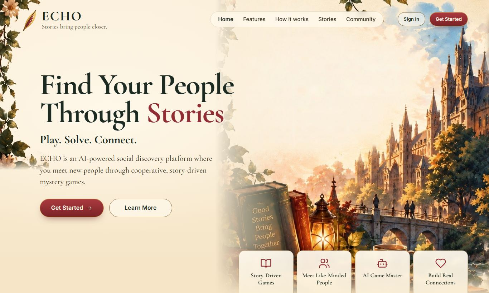
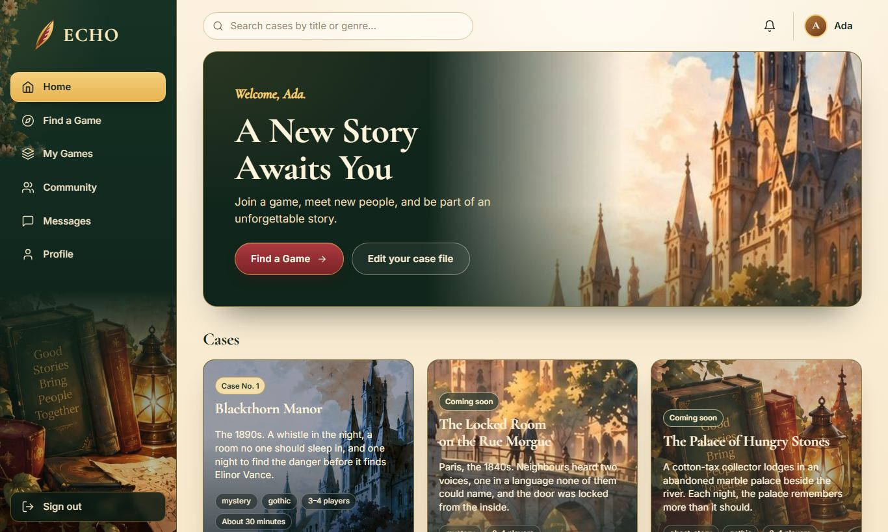
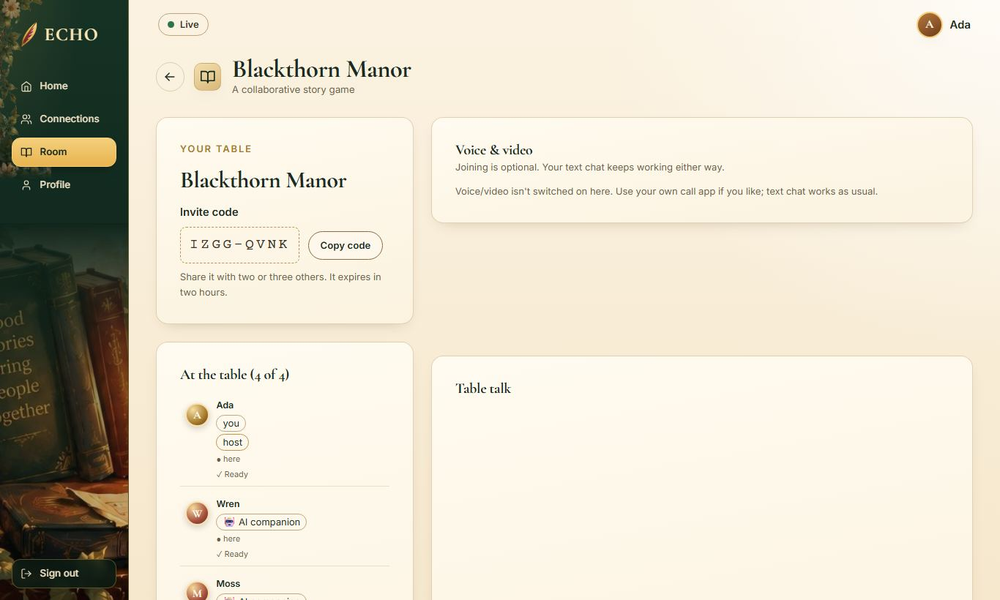
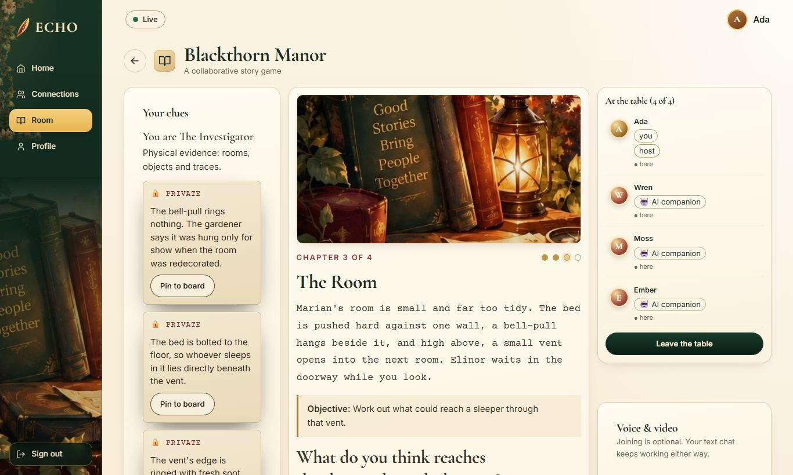
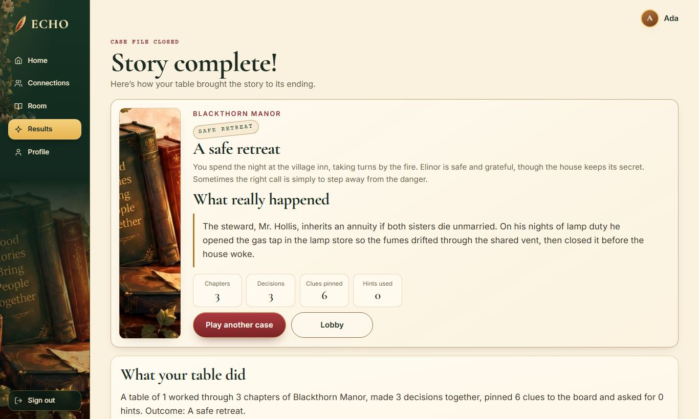

<p align="center"></p>

<p align="center"><b>Cooperative, AI-guided mysteries that turn solving together into real connection.</b></p>

ECHO seats three or four people at a table to solve a short mystery together. Each person
holds clues nobody else can see, so the case only cracks when people talk, share and decide
as a group. The story is the excuse; the conversation is the point.

**Who it's for:** students and newcomers to a campus or city who want to meet people without
the pressure of a one-to-one chat.



## How a session goes

1. **Sign up and fill in a short case file:** interests, play style and when you're free.
   Everyone confirms they are 18+; no date of birth is stored.
2. **Gather a table:** start one and share the invite code, or let ECHO find a group of 3–4
   people with shared interests. In demo mode, labelled AI companions can fill empty seats.
3. **Play:** an AI game master narrates. Everyone gets different private clues, pins them to a
   shared evidence board and votes on each decision. Anyone can float a theory in their own
   words; the AI maps it to an option and suggests it to the table, but never votes for anyone.
4. **Reflect:** the ending and the full solution, what the table did together, a private
   reflection, and a two-question pulse.
5. **Stay in touch, if both want to:** connections are mutual opt-in between people who
   finished a case together. A declined request is never shown to the person who asked.

| Lobby | The table |
|---|---|
|  |  |
| **Story room** | **Results** |
|  |  |

## What ECHO will never do

No compatibility percentages, personality scores or psychological inferences, no
leaderboards, no location tracking, no recordings, and no forced contact sharing. The UI shows
real data or nothing: no sample users, invented stats or fake testimonials.

## Features

- **Live tables** over WebSocket: presence, chat, ready-up, reconnect with full resync.
- **Server-authoritative game engine** (pure functions): 3 randomised solution variants per
  story, private clues per role, a 3-player redistribution, hints, ties and revotes.
  Nobody ever receives another player's private clues, in the DOM or over the wire.
- **AI with guard rails:** Groq, then Gemini on failure, then the authored text. A circuit
  breaker, a per-session call cap and a timeout. Output is schema-checked and must not leak
  clues or solutions. Play never waits on the AI.
- **Matching** by shared interests, play style, availability and complementary roles, explained
  in plain words ("Shared interests: books, history"). There is never a score.
- **Safety:** block, report, in-room moderation notices and an admin reports view.
- **Optional voice/video** through 8x8 Jitsi as a Service. Tokens are signed on the server and
  scoped to one room; recording is off. Text chat works whether or not anyone joins the call.

## Run it locally

Requires [uv](https://docs.astral.sh/uv/); it installs Python 3.12 for you.

```bash
cp .env.example .env          # set SECRET_KEY to 32+ random bytes
uv sync
uv run alembic upgrade head
uv run python scripts/seed.py # load the story catalogue
uv run uvicorn backend.app.main:app --reload
```

Open <http://127.0.0.1:8000>. To try a full table on your own, run
`uv run python scripts/demo.py`: it creates three labelled demo accounts and a waiting room,
then prints the sign-in details. With `DEMO_MODE=true` you can also fill a table with AI companions.

### Configuration

Everything works offline with the values in `.env.example` (`AI_PROVIDER=mock`, voice/video off).

| Variable | In `.env.example` | Purpose |
|---|---|---|
| `SECRET_KEY` | – | signs session tokens; required, 32+ bytes |
| `DATABASE_URL` | SQLite file | `postgres://…` also works after `uv sync --group postgres` |
| `AI_PROVIDER` | `mock` | `chain` uses `GROQ_API_KEY` / `GEMINI_API_KEY` with authored fallback |
| `DEMO_MODE` | `true` | lets a host fill empty seats with labelled AI companions |
| `ENABLE_VOICE_VIDEO` | `false` | needs `JAAS_APP_ID`, `JAAS_KEY_ID`, `JAAS_PRIVATE_KEY_PATH` |
| `ADMIN_EMAILS` | empty | comma-separated accounts that can read reports |

All keys stay on the server; the browser never sees them.

## Architecture

```
Browser (HTML/CSS/JS, GSAP)  ──REST /api/v1──┐
        └──────────── WebSocket ─────────────┤
                                             ▼
FastAPI modular monolith:  api → services → game engine (pure) → SQLAlchemy models
                           ai chain: Groq → Gemini → authored fallback (validated)
SQLite (WAL) by default, Postgres-ready via asyncpg     JaaS iframe (optional)
```

The full layout, every endpoint, the WebSocket protocol and the engine rules are documented in
[docs/structure.md](docs/structure.md).

## Stories and rights

Every story is an original adaptation of a public-domain work (public domain in both India
and the US). They use the original names and plots, carry no franchise branding and quote no
long source passages. Each card in the app credits its source and links to the original text.

| Case | Inspired by | Status |
|---|---|---|
| **Blackthorn Manor** | *The Adventure of the Speckled Band*, Arthur Conan Doyle (1892) | playable |
| The Locked Room on the Rue Morgue | *The Murders in the Rue Morgue*, Edgar Allan Poe (1841) | coming soon |
| The Traveller's Return | *The Time Machine*, H. G. Wells (1895) | coming soon |
| The Road of Yellow Brick | *The Wonderful Wizard of Oz*, L. Frank Baum (1900); the book only, nothing from the 1939 film | coming soon |
| The Palace of Hungry Stones | *Kshudhita Pashan* (The Hungry Stones), Rabindranath Tagore (1895), adapted from the Bengali original | coming soon |

## Tests

```bash
uv run pytest -q              # unit + integration
uv run playwright install chromium
uv run pytest -q -m e2e       # browser tests: several real browser contexts against a live server
uv run ruff check .
```

The browser suite plays full cases end to end: three people, and one person with AI
companions. It checks that each player's page and WebSocket frames hold only their own clues,
and that hostile chat renders as plain text. To run the core flows on Postgres, point
`TEST_POSTGRES_URL` at an empty throwaway database; that test resets its schema.

## Team

Soham Chowdhury · Saswata · Arkoprabho Roy

## License

[MIT](LICENSE)
